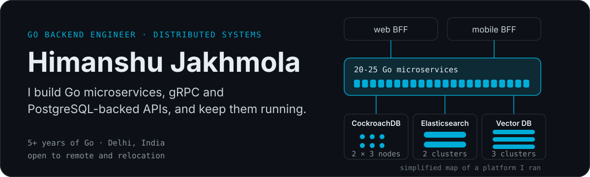

<p align="center">
  
</p>

**Go (Golang) backend engineer in Delhi. I build microservices, gRPC and PostgreSQL-backed APIs, and keep distributed systems running.** Open to remote roles and relocation.

### What I do

5+ years of production Go. At my last company I ran 20-25 Go microservices at 99.9% uptime, with under 200 ms average latency, on CockroachDB, Elasticsearch and vector databases. I cut a slow export API from 16 minutes to under 2 seconds with PostgreSQL tuning and concurrency. Now I lead backend architecture for an AI hiring platform: Temporal workflows, semantic search and a real-time voice agent. I also write about Go internals on LinkedIn, mostly GC tuning, `sync.Pool` and error handling.

### Open source

**[skill-matcher](https://github.com/Himanshujk/skill-matcher)** A Go terminal app that matches skills across Excel files, exact or semantic (FastText). Reads files concurrently.

**[machine-coding-interview-questions](https://github.com/jkaus324/machine-coding-interview-questions/pull/2)** I added Go solutions for 20 low-level design problems (merged PR #2).

```bash
git clone https://github.com/Himanshujk/skill-matcher && cd skill-matcher && go build -o skill-matcher && ./skill-matcher
```

### Stack

Go · gRPC · PostgreSQL · CockroachDB · Redis · Elasticsearch · RabbitMQ · Temporal · Kubernetes · Docker · AWS · OpenTelemetry · Prometheus · Grafana

### Find me

[LinkedIn](https://linkedin.com/in/himanshu-j-719b33b4) · [Email](mailto:himanshujakhmola143@gmail.com)

<sub>Last updated October 2026</sub>
